

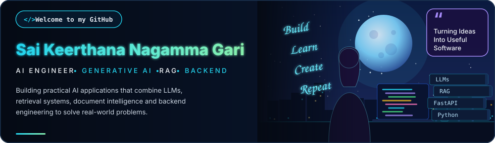

<a href="#tech-stack">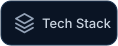</a>

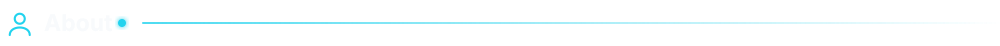

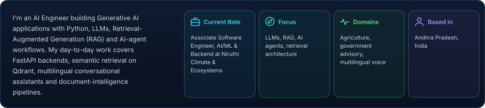

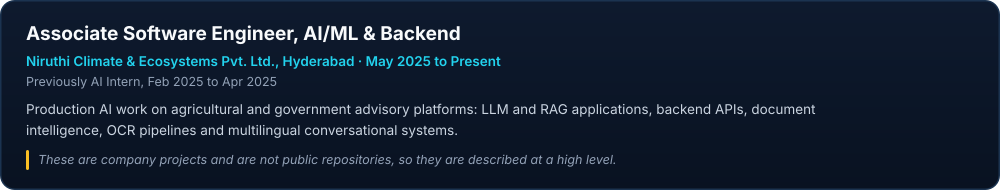

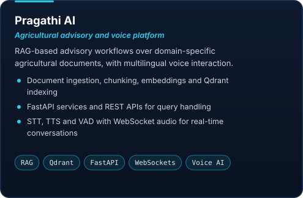
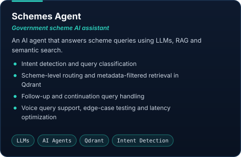

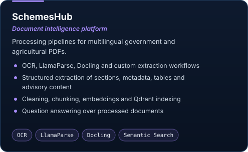
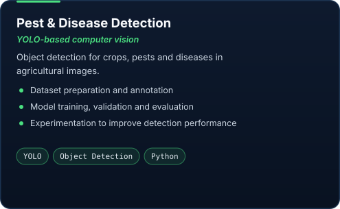

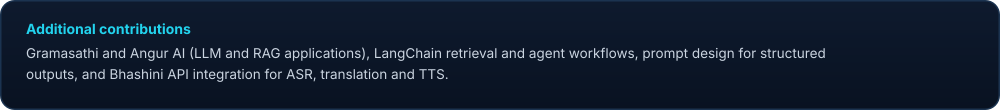

<a href="https://github.com/Nagammagari-Keerthana-0201/Pest-Infestation-Risk-Prediction-Tool-">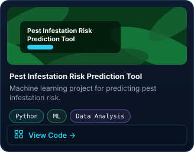</a>
<a href="https://github.com/Nagammagari-Keerthana-0201/AI-Powered_Google_Search_Chatbot">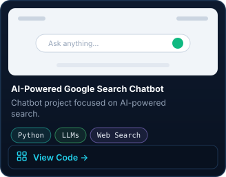</a>
<a href="https://github.com/Nagammagari-Keerthana-0201?tab=repositories">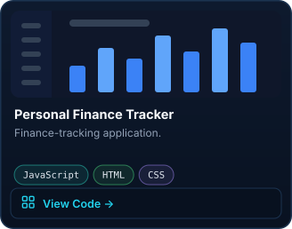</a>

<a href="https://github.com/Nagammagari-Keerthana-0201?tab=repositories">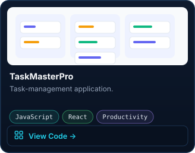</a>
<a href="https://github.com/Nagammagari-Keerthana-0201?tab=repositories">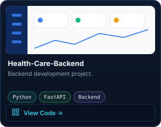</a>

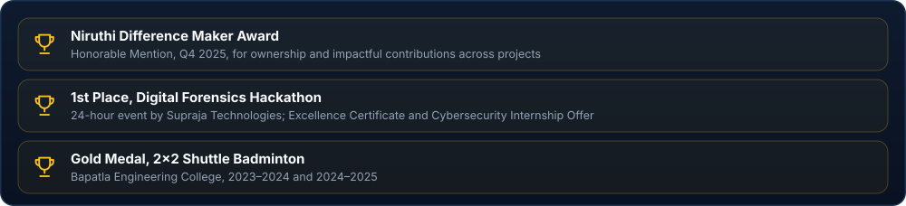

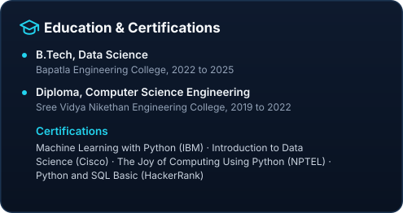
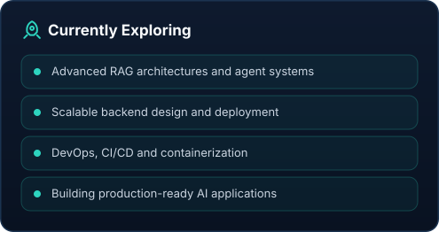

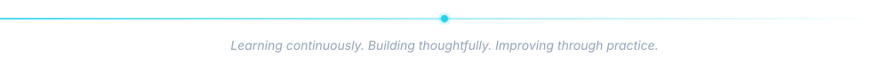
